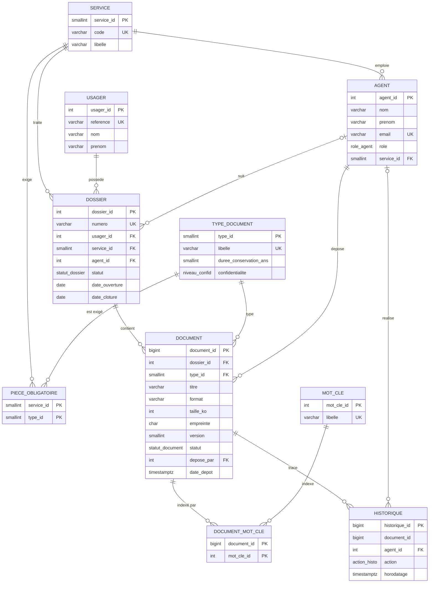

# Base de données d'une GED — Gestion Électronique de Documents

Projet **Bases de données / SQL** réalisé par [Fatou Sarr](https://sarr-fatou.github.io/) (Master 1 MIAGE — Data, IA & Big Data).

**📊 Tableau de bord en ligne : https://sarr-fatou.github.io/ged-sql/**

Pendant mon stage en *Data Management & Transformation numérique*, j'ai étudié la mise en place d'une GED pour améliorer la **qualité**, la **traçabilité** et l'**accessibilité** des données administratives. Ce projet modélise une GED de ce type de A à Z dans **PostgreSQL** : modèle conceptuel (MERISE), schéma, règles métier, traçabilité automatique, vues de pilotage, requêtes d'analyse et tests.

> ⚠️ Toutes les données sont **fictives** et générées par script. Aucune donnée réelle n'est utilisée.

## Besoins couverts

| Besoin | Solution en base |
|---|---|
| Classer les documents par dossier, usager et service | Modèle relationnel normalisé (3FN), clés étrangères |
| Vérifier qu'un dossier est complet | Table `piece_obligatoire` + fonction `pieces_manquantes()` |
| Interdire de clore un dossier incomplet | Déclencheur `controler_cloture` |
| Savoir **qui** a fait **quoi** et **quand** | Journal `historique` alimenté automatiquement par déclencheurs |
| Protéger les documents archivés | Déclencheur qui refuse toute modification |
| Respecter les durées de conservation | Vue `v_documents_echus` |
| Détecter les doublons de fichiers | Empreinte SHA-256 + index unique partiel |
| Retrouver un document rapidement | Index B-tree et index plein texte (GIN, français) |
| Piloter l'activité | Vues `v_tableau_bord_service`, `v_dossiers_en_retard` |

## Modèle conceptuel (MERISE)

- Un **service** emploie 1 à n **agents** ; un agent appartient à 1 seul service.
- Un **usager** possède 0 à n **dossiers** ; un dossier concerne 1 seul usager.
- Un **dossier** est traité par 1 **service** et suivi par 0 ou 1 **agent**.
- Un dossier contient 0 à n **documents** ; un document appartient à 1 seul dossier.
- Un document est d'un seul **type** ; un type a une durée de conservation et un niveau de confidentialité.
- Un service **exige** 0 à n types de pièces (association porteuse : `piece_obligatoire`).
- Un document est **indexé** par 0 à n **mots-clés** (association n-n : `document_mot_cle`).
- Chaque action sur un document crée une ligne d'**historique**.

## Modèle logique (MLD)



## Contenu du projet

| Fichier | Contenu |
|---|---|
| [`sql/01_schema.sql`](sql/01_schema.sql) | Tables, types énumérés, contraintes (`CHECK`, `UNIQUE`, clés étrangères), index |
| [`sql/02_triggers.sql`](sql/02_triggers.sql) | Fonctions PL/pgSQL et déclencheurs : journal d'audit, protection des archives, contrôle de clôture |
| [`sql/03_seed.sql`](sql/03_seed.sql) | Génération reproductible de données fictives : 6 services, 24 agents, 500 usagers, 900 dossiers, ~3 700 documents, ~18 000 événements d'historique |
| [`sql/04_views.sql`](sql/04_views.sql) | Vues de pilotage, réutilisables dans un outil de BI (Power BI, Tableau) |
| [`sql/05_analyses.sql`](sql/05_analyses.sql) | 11 requêtes d'analyse : CTE, fonctions de fenêtre (`SUM OVER`, `RANK`, `LAG`), `percentile_cont`, `FILTER`, `LATERAL`, recherche plein texte |
| [`sql/06_tests.sql`](sql/06_tests.sql) | 8 tests automatiques des règles métier, dans une transaction annulée |
| [`sql/07_export_dashboard.sql`](sql/07_export_dashboard.sql) | Export JSON des indicateurs pour le [tableau de bord web](docs/index.html) |
| [`.github/workflows/tests.yml`](.github/workflows/tests.yml) | Intégration continue : la base est recréée et testée à chaque modification |

## Exemples de résultats

**Complétude des dossiers en cours** (requête Q3)

| Service | Dossiers actifs | Complets | Taux de complétude |
|---|---|---|---|
| Passeports et titres | 22 | 2 | 9,1 % |
| Affaires sociales | 14 | 3 | 21,4 % |
| État civil | 9 | 2 | 22,2 % |
| Visas | 7 | 2 | 28,6 % |

→ Les dossiers de passeports sont les plus souvent incomplets : c'est le service qui exige le plus de pièces (4).

**Contrôles qualité automatiques** (requête Q8)

| Contrôle | Anomalies |
|---|---|
| Documents sans mot-clé | 911 |
| Brouillons de plus de 30 jours | 35 |
| Fichiers en double (même empreinte) | 0 |
| Dossiers clos avec pièces manquantes | 0 |

**Tests des règles métier**

```
OK  test 1 : format non autorisé refusé
OK  test 2 : dossier clos sans date de clôture refusé
OK  test 3 : création journalisée dans l'historique
OK  test 4 : validation journalisée avec l'agent connecté
OK  test 5 : modification d'un document archivé refusée
OK  test 6 : suppression tracée (la trace survit au document)
OK  test 7 : clôture d'un dossier incomplet refusée
OK  test 8 : clôture d'un dossier complet acceptée
```

## Lancer le projet

Prérequis : PostgreSQL 14 ou plus récent.

```bash
./run.sh     # crée la base "ged_demo", charge les données, lance les analyses et les tests
psql -At -d ged_demo -f sql/07_export_dashboard.sql | grep -v '^SET$' > docs/data/dashboard.json   # met à jour le tableau de bord
psql ged_demo -c "SET search_path TO ged; SELECT * FROM v_tableau_bord_service;"
```

## Pistes d'amélioration

- Sécurité : rôles PostgreSQL et *Row Level Security* pour que chaque agent ne voie que les dossiers de son service.
- Partitionnement de la table `historique` par année.
- Connexion d'un tableau de bord Power BI sur les vues.
